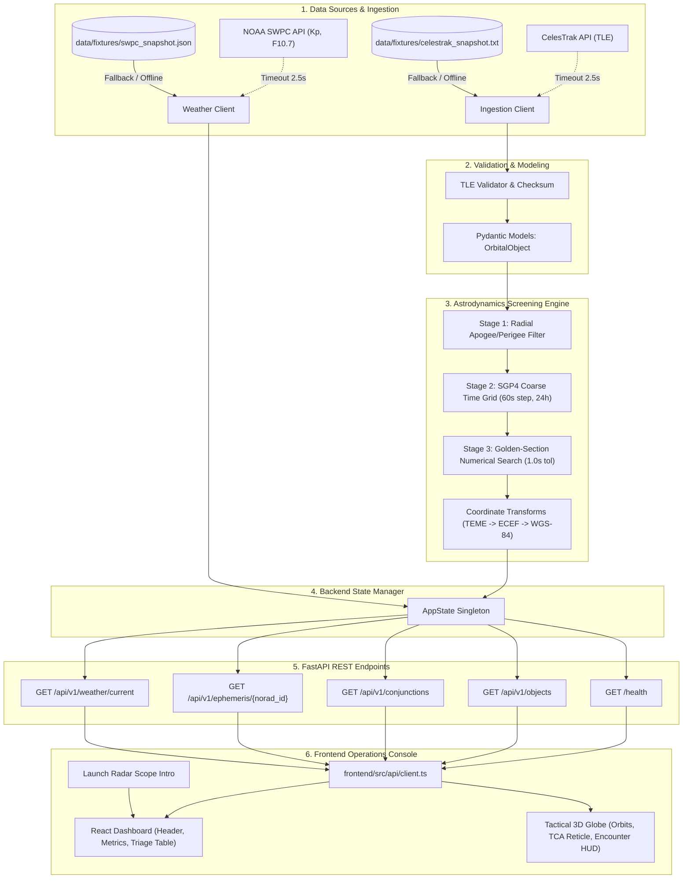

# TRAJACTRA: Orbital Intelligence & Conjunction Analysis Engine

> **Astrodynamics Screening Engine & Interactive 3D Space Situational Awareness Dashboard**  
> Developed for rapid, deterministic close-approach detection in Low Earth Orbit (LEO) using Simplified General Perturbations 4 (SGP4), analytical Euclidean filtering, and orthographic 3D visualization.

---

## 1. Project Overview

**TRAJACTRA** (also referenced as **TRAJECTRA** in the mission console) is an orbital intelligence and conjunction screening platform engineered to process public satellite ephemerides, propagate orbital trajectories across forward-looking evaluation windows, and screen candidate close approaches between cataloged space objects in Low Earth Orbit (LEO).

### The Problem It Addresses
As the population of satellites and debris fragments in Low Earth Orbit escalates, the probability of mutual orbital encounters increases dramatically. Objects traveling at orbital velocities ($\sim 7.5\text{ km/s}$) possess hypervelocity kinetic energy; an unmitigated conjunction between two orbital objects can generate thousands of cataloged debris fragments, threatening operational assets such as crewed space stations and communication constellations.

### Intended Users & Use Cases
- **Satellite Operations Teams:** Monitoring active orbital assets against high-interest conjunction candidates over a 24- to 72-hour planning horizon.
- **Space Traffic Management Researchers:** Auditing orbital geometry, relative velocity vectors, and encounter geometry without relying on opaque black-box models.
- **Mission Specialists & Analysts:** Rapidly isolating close-approach events, inspecting Keplerian parameters, and visualizing spatial geometry in 3D.

### Hackathon Reviewer Summary
TRAJACTRA demonstrates an end-to-end astrodynamics pipeline built during an 8-hour engineering hackathon:
1. **Ingests** Two-Line Element sets (TLEs) from CelesTrak with automatic local fallback fixtures.
2. **Validates** format integrity, checksums, physical boundaries, and element freshness.
3. **Screens** object pairs through a 3-stage analytical sieve (radial altitude filter $\rightarrow$ coarse time grid $\rightarrow$ golden-section extremum search) down to sub-kilometer geometric miss distances.
4. **Exposes** structured REST APIs via FastAPI with physical coordinate frame transparency (TEME, ECEF, WGS-84).
5. **Renders** encounters via an interactive 3D tactical globe with cinematic launch radar sweeps, animated trajectories, and encounter HUD overlays.

---

## 2. Problem Statement

Identifying close orbital approaches in Low Earth Orbit presents three distinct engineering and scientific challenges:

1. **Computational Scale of Pairwise Evaluation:**  
   Screening an unconstrained catalog of $N$ orbital objects requires evaluating $\frac{N(N - 1)}{2}$ candidate object pairs. Performing fine-grained numerical propagation over high-frequency time steps for all permutations is computationally prohibitive without multi-stage coarse filtering.
2. **Coordinate Frame & Mathematical Complexity:**  
   SGP4 propagators yield state vectors in the True Equator, Mean Equinox (TEME) non-rotating inertial frame. Conversely, geospatial operations, ground stations, and Earth rendering require conversion into Earth-Centered, Earth-Fixed (ECEF) coordinates via Greenwich Mean Sidereal Time (GMST), along with Coriolis velocity corrections ($\boldsymbol{\omega}_\oplus \times \mathbf{r}$) and WGS-84 geodetic transformations (latitude, longitude, altitude).
3. **Misleading Statistical Claims in Aerospace Software:**  
   Standard public Two-Line Element sets (TLEs) do not publish three-dimensional position error covariance matrices ($\mathbf{P}$). Calculating a synthetic "collision probability" ($P_c$) without empirical covariance produces mathematically invalid metrics. Operators require transparent, physics-based **Geometric Miss Distances** ($\text{km}$), relative encounter velocities ($\text{km/s}$), and heuristic alert tiers rather than artificial probability claims.

---

## 3. Solution Architecture & Pipeline

TRAJACTRA delivers an analytical, deterministic pipeline that transitions from raw orbital element ingestion to interactive 3D visual triage:

```
[ CelesTrak Live API / Local Snapshot ] 
                  │
                  ▼
   1. Ingestion & TLE Validation
      - Checksum validation (modulo 10)
      - Epoch parsing & element staleness checks
      - Physical bounds checks (e < 1.0, inclination 0-180°)
                  │
                  ▼
   2. Stage 1: Geometric Altitude Filter
      - Compares [perigee, apogee] bounds with 20 km radial margin
      - Eliminates pairs with non-overlapping orbital shells
                  │
                  ▼
   3. Stage 2: Coarse Time-Grid Propagation
      - SGP4 vector propagation across 24h lookahead (60s step)
      - TEME Euclidean distance matrix calculation
      - Isolates encounter passes where separation <= 500 km
                  │
                  ▼
   4. Stage 3: Fine Golden-Section Search
      - Golden-section extremum search within unimodal bracket
      - Refines Time of Closest Approach (TCA) to <= 1.0s tolerance
      - Evaluates Minimum Miss Distance against 50.0 km threshold
                  │
                  ▼
   5. Coordinate Transformation Engine
      - Computes GMST rotation: TEME -> ECEF
      - Applies Coriolis correction: v_ecef = R * v_teme - (omega x r)
      - Projects ECEF -> WGS-84 Geodetic (Lat, Lon, Alt)
                  │
                  ▼
   6. FastAPI REST Layer (port 8000)
      - /health, /api/v1/objects, /api/v1/conjunctions, /api/v1/weather
                  │
                  ▼
   7. Interactive Frontend Console (ports 3000 / 4173)
      - Launch Radar intro animation & progress loader
      - Tactical 3D Globe with 3 active trajectories & encounter HUD
      - Multi-color alert triage cards & object catalog
```

### Candidate Close Approaches vs. Confirmed Collisions
TRAJACTRA explicitly differentiates between a **candidate close approach** and a **confirmed collision**:
- **Candidate Close Approach:** A deterministic geometric calculation indicating that two orbital trajectories pass within a specified distance threshold ($d \le 50.0\text{ km}$) at a specific Time of Closest Approach (TCA).
- **Confirmed Collision:** An event that cannot be asserted from TLE data alone. Because public TLEs lack covariance matrices, all screening events are categorized into **Screening Alert Tiers** (`CRITICAL`, `WARNING`, `WATCH`, `MONITOR`) based strictly on geometric miss distance.

---

## 4. Features & Implementation Status

| Feature | Implementation Details | Status |
| :--- | :--- | :--- |
| **Interactive 3D Tactical Globe** | Orthographic spherical projection with real Natural Earth 110m landmasses, graticule, active orbital trajectories, occlusion-aware rendering, animated satellites, and auto-rotation. | **Functional** |
| **Cinematic Launch Radar Intro** | Circular radar scope with rotating yellow sweep beam, cyan range rings, satellite blips, live telemetry counter (`0% -> 100%`), and smooth transition into workspace. | **Functional** |
| **Red Encounter Reticle & HUD** | Double concentric red rings (`#EF4444`) with pulsing animation at encounter node, red dashed connecting beam between encounter satellites, and tactical HUD box displaying satellite IDs and miss distance. | **Functional** |
| **Orbital Object Catalog** | Paginated catalog (`/api/v1/objects`) with search filtering, Keplerian parameters (inclination, eccentricity, semi-major axis, apogee, perigee, period, BSTAR drag). | **Functional** |
| **Conjunction Screening Pipeline** | 3-stage analytical screening engine (`/api/v1/conjunctions`) evaluating Time of Closest Approach (TCA), geometric miss distance ($\text{km}$), relative encounter speed ($\text{km/s}$), and screening tier. | **Functional** |
| **Ephemeris Time Series** | Step-by-step orbital ephemeris generation (`/api/v1/ephemeris/{norad_id}`) providing TEME, ECEF, and WGS-84 geodetic coordinates. | **Functional** |
| **Space Weather Context** | Real-time NOAA SWPC data client (`/api/v1/weather/current`) fetching Planetary K-index, 10.7cm Solar Radio Flux, and upper-atmospheric drag notes. | **Functional** |
| **Air-Gapped Offline Mode** | Single flag (`--offline` or `OFFLINE_MODE=true`) routing all data ingestion to verified fixtures in `data/fixtures/`. | **Functional** |
| **Risk Analysis / Maneuver Planning** | UI navigation slot present in console. Backend calculation and propulsion modeling are currently unlinked. | *Placeholder / UI Only* |
| **Reports View** | Reports interface present in console; automated PDF/export service is pending. | *Placeholder / UI Only* |
| **Model Monitor View** | Model health dashboard card present in console; ML model evaluation service is intentionally not implemented. | *Placeholder / UI Only* |

---

## 5. Technology Stack

### Backend
- **Python 3.10+ / 3.11+:** Core runtime for astrodynamics calculations.
- **FastAPI (`>=0.110.0`):** High-performance asynchronous REST API framework serving endpoints with automated OpenAPI/Swagger documentation.
- **Uvicorn (`>=0.28.0`):** ASGI web server implementation.
- **SGP4 (`>=2.23`):** Official implementation of the Simplified General Perturbations 4 satellite orbit propagation model.
- **NumPy (`>=1.26.0`):** Vectorized Euclidean distance matrices, coordinate rotation matrices, and norm calculations.
- **Pydantic v2 (`>=2.6.0`):** Schema validation, physical boundary constraints, and Data Transfer Objects (DTOs).
- **HTTPX (`>=0.27.0`):** Asynchronous HTTP client with 2.5s timeouts for external data fetching.
- **Pytest (`>=8.0.0`):** Unit and integration testing suite.

### Frontend
- **React 19 & TypeScript:** Component architecture and type-safe UI logic.
- **Vite (`^8.3.0`):** High-speed frontend build tool and development server.
- **Three.js (`^0.186.1`) & @react-three/fiber:** 3D WebGL rendering engine and React declarative bindings.
- **Tailwind CSS (`^4.3.3`) & Vanilla CSS Tokens:** Modern dark aerospace theme, glassmorphic panels, and curated multi-color accent trims.
- **Lucide React (`^1.55.0`):** Iconography for telemetry status and navigation.
- **Recharts (`^3.10.1`):** Charting components for encounter timelines and space weather telemetry.

### Data Sources & Fixtures
- **CelesTrak GP API:** Live NORAD General Perturbations Two-Line Element (TLE) orbital element sets.
- **NOAA Space Weather Prediction Center (SWPC):** Real-time planetary K-index and 10.7cm solar radio flux.
- **Natural Earth (110m TopoJSON):** Offline landmass polygons and geopolitical boundaries.
- **Local Fallback Fixtures (`data/fixtures/`):** Committed offline snapshots ensuring 100% operation without network access.

---

## 6. System Architecture



---

## 7. Repository Structure

```
HackSeries/
├── backend/
│   ├── config.py                     # Configuration settings & screening thresholds
│   ├── main.py                       # FastAPI application entrypoint & lifespan events
│   ├── requirements.txt              # Python package dependencies
│   ├── core/
│   │   ├── ingestion/
│   │   │   ├── cache.py              # Cache management & fixture loader
│   │   │   └── client.py             # CelesTrak HTTP ingestion client
│   │   ├── propagation/
│   │   │   ├── propagator.py         # SGP4 propagation wrapper & state extraction
│   │   │   └── transforms.py         # GMST, TEME-to-ECEF, Coriolis & Geodetic math
│   │   ├── screening/
│   │   │   ├── golden_search.py      # Golden-section 1.0s extremum search
│   │   │   ├── pipeline.py           # 3-Stage screening orchestration pipeline
│   │   │   └── radial_filter.py      # Stage 1 geometric perigee/apogee filter
│   │   ├── state.py                  # In-memory AppState singleton
│   │   ├── validation/
│   │   │   └── validator.py          # TLE checksum, epoch, & physical bounds parser
│   │   └── weather/
│   │       └── client.py             # NOAA SWPC client & geomagnetic status
│   ├── models/
│   │   ├── conjunction.py            # Conjunction event & screening DTOs
│   │   ├── ephemeris.py              # Cartesian 3D, velocity, & trajectory DTOs
│   │   ├── orbital.py                # Keplerian parameters & catalog models
│   │   └── weather.py                # Space weather state schema
│   ├── routes/
│   │   ├── conjunctions.py           # Conjunction event query & filtering endpoints
│   │   ├── ephemeris.py              # Satellite trajectory ephemeris endpoint
│   │   ├── health.py                 # System health & data provenance endpoint
│   │   ├── objects.py                # Catalog listing, search, & pagination
│   │   └── weather.py                # Current space weather endpoint
│   └── tests/
│       ├── test_api.py               # FastAPI endpoint integration tests
│       ├── test_propagation.py       # SGP4 propagation & coordinate math tests
│       ├── test_screening.py         # 3-stage screening & synthetic benchmark tests
│       └── test_validation.py        # TLE parser & checksum validation tests
├── data/
│   ├── cache/                        # Runtime cache directory (gitignored)
│   └── fixtures/
│       ├── celestrak_snapshot.txt    # Offline TLE catalog snapshot
│       ├── swpc_snapshot.json        # Offline space weather snapshot
│       ├── synthetic_close_pair.tle  # Calibrated benchmark encounter pair
│       └── synthetic_close_pair_metadata.json
├── frontend/
│   ├── index.html                    # Root HTML document & radar overlay markup
│   ├── package.json                  # Frontend dependencies and npm scripts
│   ├── vite.config.ts                # Vite configuration with port 3000 & API proxy
│   ├── app.js                        # Standalone dashboard controller & radar driver
│   ├── styles.css                    # Design system tokens, radar, & panel styles
│   ├── tactical-globe.js             # Zero-dependency 3D tactical globe implementation
│   └── src/
│       ├── App.tsx                   # React root navigation component
│       ├── api/                      # Typed API client functions & interfaces
│       └── components/
│           ├── alerts/               # Alert triage table component
│           ├── dashboard/            # Header, metrics bar, disclaimer banner
│           ├── globe/                # Three.js globe & tactical orbit views
│           ├── landing/              # Cinematic landing page
│           ├── objects/              # Satellite catalog view
│           └── weather/              # Space weather telemetry card
├── SpaceTech-Hackathon/              # Alternate synchronized frontend workspace
├── run_demo.py                       # Single-command concurrent launcher
└── README.md                         # Authoritative project documentation
```

---

## 8. Prerequisites

- **Python:** Python 3.10, 3.11, 3.12, or 3.13 (64-bit recommended).
- **Node.js:** Node.js 18.0.0+ (Node.js 20 LTS or Node.js 24 recommended).
- **Package Manager:** `npm` (Node Package Manager).
- **Operating System:** Windows 10/11, macOS, or Linux.
- **Web Browser:** Modern evergreen browser (Chrome, Edge, Firefox, Safari) with WebGL and SVG support.

---

## 9. Installation & Setup

### Step 1: Clone the Repository
```bash
git clone https://github.com/SanskarArnale-07/HackSeries.git
cd HackSeries
```

### Step 2: Set Up Backend Environment (Python)
1. **Create and activate a virtual environment:**
   - **Windows (PowerShell):**
     ```powershell
     python -m venv venv
     .\venv\Scripts\Activate.ps1
     ```
   - **Linux / macOS:**
     ```bash
     python3 -m venv venv
     source venv/bin/activate
     ```
2. **Install backend dependencies:**
   ```bash
   pip install -r backend/requirements.txt
   ```

### Step 3: Set Up Frontend Environment (Node.js)
1. Navigate to the `frontend/` directory:
   ```bash
   cd frontend
   ```
2. Install dependencies:
   - **Windows (PowerShell - avoid script execution policy blocks):**
     ```powershell
     npm.cmd install
     ```
   - **Linux / macOS:**
     ```bash
     npm install
     ```
3. Return to the project root:
   ```bash
   cd ..
   ```

---

### Step 4: Starting the Application

#### Option A: Single-Command Launcher (Recommended)
You can launch both the FastAPI backend (port 8000) and the Vite frontend (port 3000) concurrently:
```bash
python run_demo.py
```

To run in **air-gapped / offline demonstration mode** (zero external network calls):
```bash
python run_demo.py --offline
```

#### Option B: Manual Execution (Two Terminals)

**Terminal 1 — FastAPI Backend:**
```powershell
# From project root
python -m uvicorn backend.main:app --host 127.0.0.1 --port 8000 --reload
```
*Backend will be accessible at `http://127.0.0.1:8000` with Swagger docs at `http://127.0.0.1:8000/docs`.*

**Terminal 2 — Frontend Console:**
```powershell
# From project root
cd frontend
npm.cmd run dev -- --port 3000
```
*Frontend will be accessible at `http://localhost:3000`.*

---

## 10. Configuration & Environment Variables

All settings are managed via [`backend/config.py`](file:///c:/Users/dell/Desktop/HackSeries/backend/config.py) and can be customized through environment variables:

| Variable | Type | Default | Description |
| :--- | :--- | :--- | :--- |
| `BACKEND_PORT` | `int` | `8000` | Port for the FastAPI Uvicorn server |
| `FRONTEND_PORT` | `int` | `3000` | Port for the frontend interface |
| `OFFLINE_MODE` | `bool` | `false` | When `true`, disables external network calls and uses local fixtures |
| `SCREENING_THRESHOLD_KM` | `float` | `50.0` | Maximum miss distance threshold for reporting conjunction events |
| `COARSE_PROXIMITY_TRIGGER_KM`| `float` | `500.0` | Coarse time-grid proximity trigger bounding candidate encounters |
| `SCREENING_WINDOW_HOURS` | `int` | `24` | Forward lookahead screening window duration in hours |
| `COARSE_STEP_SECONDS` | `int` | `60` | Step size for Stage 2 coarse propagation grid |

### Example Environment Configuration (`.env`)
Create an optional `.env` file in the project root:
```env
BACKEND_PORT=8000
FRONTEND_PORT=3000
OFFLINE_MODE=false
SCREENING_THRESHOLD_KM=50.0
COARSE_PROXIMITY_TRIGGER_KM=500.0
SCREENING_WINDOW_HOURS=24
COARSE_STEP_SECONDS=60
```

---

## 11. Data Sources & Data Flow

1. **Orbital TLE Catalog:**
   - **Primary Live Source:** CelesTrak Stations (`https://celestrak.org/NORAD/elements/gp.php?GROUP=stations&FORMAT=tle`) and Active Satellites.
   - **Timeout Policy:** 2.5-second HTTP timeout with automatic fallback to local fixtures upon network failure.
   - **Local Fixture:** `data/fixtures/celestrak_snapshot.txt`.
2. **Space Weather Telemetry:**
   - **Primary Live Source:** NOAA SWPC Planetary K-index (`planetary_k_index_1m.json`) and 10.7cm Solar Radio Flux (`f107_cm_flux.json`).
   - **Local Fixture:** `data/fixtures/swpc_snapshot.json`.
3. **Calibrated Benchmark Encounter Pair:**
   - Located at `data/fixtures/synthetic_close_pair.tle`.
   - Used for unit and regression testing to verify that known close-approach geometry is reliably detected within predicted mathematical tolerances.

---

## 12. API Documentation

The FastAPI backend exposes the following endpoints (available interactively at `http://127.0.0.1:8000/docs`):

### 1. Root & System Health
- **`GET /`**
  - **Description:** Returns service descriptor, version, and link catalog.
- **`GET /health`**
  - **Description:** Health check exposing system status, catalog size, screening status, and data source provenance.
  - **Sample Response:**
    ```json
    {
      "status": "HEALTHY",
      "service": "TRAJACTRA_BACKEND",
      "timestamp_utc": "2026-10-11T12:00:00Z",
      "catalog_size": 100,
      "screening_engine_status": "ONLINE",
      "data_source": "CELESTRAK_LIVE",
      "is_offline_mode": false,
      "events_screened": 3
    }
    ```

### 2. Orbital Objects (`/api/v1/objects`)
- **`GET /api/v1/objects`**
  - **Query Parameters:** `limit` (default 100, max 500), `offset` (default 0), `search` (string).
  - **Description:** Lists tracked objects with Keplerian orbital parameters, element age, and staleness flag.
- **`GET /api/v1/objects/{norad_id}`**
  - **Description:** Retrieves metadata and Keplerian orbital parameters for a specific NORAD ID.

### 3. Conjunction Events (`/api/v1/conjunctions`)
- **`GET /api/v1/conjunctions`**
  - **Query Parameters:** `tier` (`CRITICAL`, `WARNING`, `WATCH`, `MONITOR`), `max_miss_km` (float).
  - **Description:** Retrieves screened close approaches over the evaluation window.
  - **Sample Response:**
    ```json
    {
      "screening_metadata": {
        "evaluation_timestamp_utc": "2026-10-11T12:00:00Z",
        "screening_window_hours": 24,
        "threshold_km": 50.0,
        "total_pairs_screened": 4950,
        "events_count": 1,
        "status": "CONJUNCTIONS_DETECTED"
      },
      "events": [
        {
          "event_id": "conj-25544-44238",
          "primary_object": { "norad_id": 25544, "name": "ISS (ZARYA)", "type": "PAYLOAD" },
          "secondary_object": { "norad_id": 44238, "name": "CZ-4B DEB", "type": "DEBRIS" },
          "tca_utc": "2026-10-11T17:42:15Z",
          "miss_distance_km": 3.42,
          "relative_speed_km_s": 14.12,
          "screening_tier": "CRITICAL",
          "scientific_disclaimer": "Heuristic geometric screening indicator only..."
        }
      ]
    }
    ```
- **`GET /api/v1/conjunctions/{event_id}`**
  - **Description:** Retrieves telemetry, relative velocity vectors, and WGS-84 encounter coordinates for a specific event.

### 4. Ephemeris Trajectory (`/api/v1/ephemeris`)
- **`GET /api/v1/ephemeris/{norad_id}`**
  - **Query Parameters:** `step_seconds` (default 60, range 10–300), `duration_hours` (default 2.0, range 0.5–24.0).
  - **Description:** Calculates discrete time series with TEME Cartesian, ECEF Cartesian, and WGS-84 Geodetic coordinates for 3D visualization.

### 5. Space Weather (`/api/v1/weather`)
- **`GET /api/v1/weather/current`**
  - **Description:** Returns current NOAA SWPC geomagnetic indices ($Kp$), 10.7cm solar radio flux ($F_{10.7}$), and atmospheric drag context.

---

## 13. How to Use the Application

1. **Launch & Initialization:**
   - Open [http://localhost:3000](http://localhost:3000) (or [http://localhost:4173](http://localhost:4173)).
   - Observe the circular **Launch Radar** screen displaying real-time data sync progress. You can let it complete (`100%`) or click **ENTER WORKSPACE ➔** to immediately enter the console.
2. **Overview & Tactical 3D Globe:**
   - View tracked primary assets (`SAT-7421 / ISS`) and encounter candidates (`SAT-9812 / CZ-4B`).
   - Interact with the 3D globe: drag to rotate around 3 axes, toggle auto-rotation via `SPIN: AUTO`, or reset the view with `RESET VIEW`.
   - Inspect the **Red Conjunction Encounter HUD**: double concentric reticle at the intersection node, red dashed connecting beam between encounter satellites, and tactical callout box displaying satellite IDs and miss distance.
3. **Object Catalog:**
   - Switch to **Object Catalog** in the navigation bar to browse tracked LEO objects.
   - Filter by name or NORAD ID to inspect perigee, apogee, inclination, and element freshness.
4. **Conjunctions Triage Table:**
   - Select **Conjunctions** to view screened close-approach events sorted by severity.
   - Filter by alert tier (`CRITICAL`, `WARNING`, `WATCH`, `MONITOR`).
5. **Space Weather & Operational Status:**
   - Access **Space Weather** to review geomagnetic activity ($Kp$) and solar flux conditions influencing upper-atmospheric density and drag.

---

## 14. Scientific Methodology & Limitations

### SGP4 Propagation Model
TRAJACTRA utilizes the standard `sgp4` library implementing the analytical Simplified General Perturbations 4 theory. SGP4 accounts for:
- Earth oblateness perturbations ($J_2$, $J_3$, $J_4$).
- Low-altitude atmospheric drag parameterized by the element set's $B^*$ drag term.
- Lunar and solar gravitational perturbations for deeper orbits.

### 3-Stage Conjunction Screening Methodology
1. **Stage 1 — Apogee/Perigee Radial Filter:**  
   Computes the physical altitude bounds for each object:
   $$\text{Perigee Radius } r_p = a(1 - e), \quad \text{Apogee Radius } r_a = a(1 + e)$$
   Two objects $A$ and $B$ are rejected immediately if:
   $$r_{p,A} - r_{a,B} > \Delta_{\text{margin}} \quad \text{or} \quad r_{p,B} - r_{a,A} > \Delta_{\text{margin}} \quad (\Delta_{\text{margin}} = 20.0\text{ km})$$
2. **Stage 2 — Coarse Time-Grid Sieve:**  
   Propagates remaining pairs over a 24-hour window using a $60\text{-second}$ time step. Calculates Euclidean separation:
   $$d(t) = \|\mathbf{r}_A(t) - \mathbf{r}_B(t)\|_{\text{TEME}}$$
   Passes where $d(t) \le 500.0\text{ km}$ are tagged as candidate encounter brackets.
3. **Stage 3 — Golden-Section Extremum Search:**  
   Applies an iterative golden-section search over identified encounter brackets to find the exact local minimum down to a tolerance of $\le 1.0\text{ second}$.
4. **Alert Tier Classification:**
   - `CRITICAL`: Miss distance $< 5.0\text{ km}$
   - `WARNING`: Miss distance $5.0\text{ km} \le d < 15.0\text{ km}$
   - `WATCH`: Miss distance $15.0\text{ km} \le d < 30.0\text{ km}$
   - `MONITOR`: Miss distance $30.0\text{ km} \le d \le 50.0\text{ km}$

### Scientific Limitations & Aerospace Disclaimers
> **IMPORTANT AEROSPACE NOTICE:**  
> TRAJACTRA is an academic, research, and hackathon prototype.
> 1. **No Collision Probability ($P_c$):** Public Two-Line Elements (TLEs) do not contain error covariance matrices ($\mathbf{P}$). The metric reported by TRAJACTRA is strictly **Geometric Miss Distance** ($\text{km}$), not a validated probability of collision.
> 2. **TLE Accuracy & Staleness:** Public TLEs have inherent position uncertainties typically ranging from hundreds of meters to several kilometers, which degrade over time.
> 3. **Non-Operational Status:** This platform is not certified for operational flight safety decisions, orbit maneuver planning, or collision avoidance maneuvers.

---

## 15. Testing & Validation

The backend test suite is structured in `backend/tests/` and uses `pytest`:

```bash
# Execute the complete test suite
python -m pytest backend/tests -v
```

### Test Suite Structure
1. **`test_validation.py` (Validation Tests):**
   - Validates TLE checksum calculation (modulo-10 rule).
   - Validates epoch parsing and physical bounds checking.
   - Tests rejection of corrupted line lengths, invalid checksums, and mismatched NORAD IDs.
2. **`test_propagation.py` (Propagation & Astrodynamics Tests):**
   - Validates SGP4 orbital propagation against reference ISS state vectors.
   - Verifies propagation error code preservation (ensuring decayed satellites are never replaced with synthetic zeros `[0.0, 0.0, 0.0]`).
   - Validates Coriolis velocity corrections ($\boldsymbol{\omega}_\oplus \times \mathbf{r}$) in TEME-to-ECEF velocity transformations.
3. **`test_screening.py` (Screening Pipeline Tests):**
   - Validates Stage 1 radial filter rejection of non-overlapping orbits.
   - Tests screening alert tier thresholds.
   - Executes the end-to-end screening pipeline against the calibrated `synthetic_close_pair.tle` fixture to verify close-approach detection.
4. **`test_api.py` (API Contract Tests):**
   - Validates responses and headers for `/health`, `/api/v1/objects`, `/api/v1/conjunctions`, `/api/v1/ephemeris/{norad_id}`, and `/api/v1/weather/current`.
   - Confirms the inclusion of the required `X-Scientific-Disclaimer` HTTP response header.

*Note: Running tests requires that backend dependencies (`pytest`, `fastapi`, `sgp4`, `numpy`, `httpx`) are installed in your active Python environment.*

---

## 16. Troubleshooting

### 1. PowerShell Script Execution Policy Error (`npm.ps1 cannot be loaded`)
- **Symptom:** Running `npm` on Windows PowerShell results in `File C:\Program Files\nodejs\npm.ps1 cannot be loaded... not digitally signed`.
- **Solution:** Use `npm.cmd` instead of `npm`, or run:
  ```powershell
  npm.cmd run dev
  ```

### 2. `'vite' is not recognized as an internal or external command`
- **Symptom:** Starting the frontend fails because the `vite` executable is missing.
- **Solution:** Dependencies have not been installed. Run `npm.cmd install` (Windows) or `npm install` (Linux/macOS) inside the `frontend/` directory.

### 3. Backend Offline or Connection Refused on Port 8000
- **Symptom:** Frontend indicates `AWAITING DATA` and requests to `http://localhost:8000/health` fail.
- **Solution:** Ensure the FastAPI backend is running via `python run_demo.py` or manually via:
  ```powershell
  python -m uvicorn backend.main:app --port 8000 --host 127.0.0.1
  ```

### 4. Upstream Data Fetch Timeouts (CelesTrak / NOAA SWPC)
- **Symptom:** The backend log indicates timeout fetching live TLEs or SWPC indices.
- **Solution:** Start the engine with `--offline` or set `OFFLINE_MODE=true`. TRAJACTRA automatically falls back to verified fixtures in `data/fixtures/` with zero external network dependency.

---

## 17. Future Improvements (Planned Work)

The following features represent architectural extensions beyond the initial hackathon scope:
- [ ] **Covariance Matrix Ingestion:** Integrating high-precision Conjunction Data Messages (CDMs) from Space-Track to calculate formal 2D/3D collision probabilities ($P_c$) via Foster and Akella methods.
- [ ] **Active Maneuver Planning Engine:** Implementing impulsive ($\Delta v$) and continuous low-thrust orbital maneuver planning algorithms to resolve candidate conjunctions.
- [ ] **Full Catalog Scalability:** Parallelizing the Stage 1 and Stage 2 screening pipelines across multi-core CPU workers to screen the full active LEO catalog ($>10,000$ objects).
- [ ] **Automated Report Generation:** Exporting formal PDF close-approach summary reports for aerospace operators.

---

## 18. Contributors

This project was developed by the TRAJACTRA engineering team:

- **Subee2801** ([@Subee2801](https://github.com/Subee2801)) — Project Contributor & Frontend Visualization
- **Sanskar Arnale** ([@SanskarArnale-07](https://github.com/SanskarArnale-07)) — Project Lead & Astrodynamics Pipeline
- **Srushti** ([@Srushti07-del](https://github.com/Srushti07-del)) — Data Ingestion & Integration

---

## 19. License

No license is currently specified in this repository. All rights are reserved by the project authors. Inquire with the repository owners for licensing or reuse permissions.